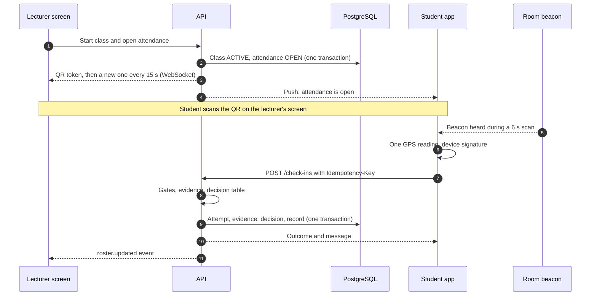

# Attendance workflow

The lecturer starts the class and opens attendance. Students scan the rotating QR, and their phones add classroom evidence. The server decides each check-in and pushes the result to the lecturer's live roster within a second. When attendance closes, enrolled students with no record are marked absent. Cancelled and voided classes never count against anyone.

**Status:** design draft (2026-11-08). Verification rules are in [PRESENCE_VERIFICATION.md](PRESENCE_VERIFICATION.md).

## 1. Starting a class and opening attendance

| Step | What the server does |
| --- | --- |
| 1. Validate the lecturer | Signed in, active role Lecturer, permission `class_sessions.start` |
| 2. Validate the course assignment | The lecturer is assigned to one of the session's sections |
| 3. Validate the scheduled class | Status allows ACTIVE (CLASS_LIFECYCLE.md §4), and the time is between 15 min before the start and the scheduled end |
| 4. Activate the attendance session | One transaction: class becomes ACTIVE with `actualStart`; an attendance session is created with a fresh QR secret, `lateAfter`, `closesAt` and the current policy version |
| 5. Generate the dynamic QR | The first token is pushed to the lecturer's screen; it rotates every 15 s |
| 6. Notify enrolled students | Push and in-app: "Attendance is open for CSC 204 until 10:20" (example) |
| 7. Collect check-in attempts | `POST /check-ins` |
| 8. Validate enrolment | For each attempt |
| 9. Collect verification evidence | QR, BLE, GPS, device, integrity |
| 10. Decide on the backend | Verification engine |
| 11. Update the live roster | WebSocket event to the lecturer and any administrator watching |

**As built (Phase 5 step 1).** Steps 1–6 are built: `POST /class-sessions/:id/attendance/open` checks the lecturer and the class, starts the class in the same transaction when needed, creates the attendance session with its encrypted QR secret and the current verification policy version, and writes `ATTENDANCE_OPENED`, which notifies enrolled students and reps. Check-in (steps 7–10) is built in step 2 (`POST /check-ins`, see API_DOCUMENTATION); the live roster (step 11) is step 3.

Starting the class and opening attendance are one tap by default. A lecturer can also start the class first and open attendance later, for example at the end of a lecture.

**Times:** `lateAfter` is the later of the scheduled start and the moment attendance opened, plus 15 min. `closesAt` is the opening time plus 20 min. The lecturer can change both when opening, close early, extend, or reopen once before the scheduled end, with a reason. All of these are audited. The defaults depend on D-09.

## 2. The whole exchange



## 3. The student's side

These screens match the check-in boards on the design canvas.

1. **Scan.** The camera opens straight away. If no attendance session is open for the student, the app says so instead of showing a scanner that cannot work.
2. **Verifying.** It shows a progress line for each check, such as "QR code read", "Classroom detected" and "Location checked".
3. **Result.**
   - *Confirmed*, with the server time.
   - *Waiting for lecturer*, when pending.
   - *Not verified*, with the reason and the next step.

The app shows "Confirmed" only after the server says so. Attendance reminders stop once a check-in is confirmed.

## 4. Attendance statuses

| Status | How it is reached | Counts as |
| --- | --- | --- |
| PRESENT | VERIFIED before `lateAfter`, or an approved pending check-in, or a lecturer-assisted check-in | Attended |
| LATE | VERIFIED after `lateAfter`. Lateness is judged from the attempt's server receipt time, not the time someone approved it. | Attended (late weight per D-09) |
| PENDING | PENDING_VERIFICATION outcome | Not counted until decided |
| UNDER_REVIEW | MANUAL_REVIEW_REQUIRED outcome, or the student asked for review | Not counted until decided |
| REJECTED | Last attempt rejected and no better result | Absence (can be disputed) |
| ABSENT | No record when attendance closed | Absence (can be disputed) |
| EXCUSED | Approved excuse request | Removed from the total |
| VOIDED | The class was voided after attendance started | Removed from the total |

**Records only move up.** The order is PRESENT/LATE above UNDER_REVIEW, above PENDING, above REJECTED. A later attempt can raise a record but never lower it: a failed retry after a verified check-in changes nothing. Only an audited correction can lower a record.

## 5. Closing attendance

At `closesAt`, or when the lecturer closes it, one transaction:

- closes the attendance session,
- inserts `ABSENT` records for every eligible student without one (`ON CONFLICT DO NOTHING`, so the step is safe to repeat),
- writes the class event.

Pending and under-review check-ins stay as they are. The lecturer is reminded at class end and the next morning. After 72 hours, any still undecided are escalated to the administrator. They are never silently converted to absent.

**As built (Phase 5 step 1):** closing, the sweeper (every minute: time up, or the class ended) and voiding are built. Records are never deleted (database trigger) and corrections are append-only. A class voided after attendance started has every record set to VOIDED, each with a correction (source VOID). Reminders and the 72-hour escalation come with step 4.

A student is **eligible** for a session if they were enrolled in one of its sections at the scheduled start: `enrolledAt` on or before the start, and not dropped before it. Students who join a course late are not marked absent for classes before they joined.

## 6. Live lecturer dashboard

The roster screen (design canvas board "Lecturer · Live attendance") shows:

- course code and name, classroom, scheduled and actual start, time remaining;
- counts of enrolled, present, late, pending, rejected attempts and not checked in;
- a roster with photo, name, student ID, status, check-in time and an evidence summary such as "QR ✓ · Beacon weak · Device ✓";
- Review buttons on pending and rejected rows;
- a "Needs attention" panel for pending verifications and risk flags;
- beacon health: online or suspected faulty, last heard, battery;
- a connection indicator: "Live · synced 2 s ago", or "Reconnecting…" with the last sync time.

**As built (Phase 5 step 3):** the roster endpoint, live events with `seq`, approving and rejecting waiting check-ins (one by one, or together in degraded mode) and assisted check-in are built; the screens come in step 6. Details in API_DOCUMENTATION §3 and §4.

**Realtime protocol.** The lecturer's screen joins the room `attendance:<sessionId>` after the server checks that they may see it. Each event carries an increasing `seq`. The client keeps the last `seq` it applied. On a gap, or on reconnect, it reloads the full roster from `GET /attendance-sessions/:id/roster` and continues. The full event list is in [API_DOCUMENTATION.md](API_DOCUMENTATION.md) §4.

## 7. Correcting attendance

| Route | Who | Rules |
| --- | --- | --- |
| Approve or reject a pending check-in | Lecturer, Administrator | From the roster or the review queue; note optional on approval, required on rejection |
| Lecturer correction | Assigned lecturer | Within 14 days of the class; reason required. Later corrections need administrator approval. |
| Dispute | Student submits; lecturer or administrator decides | One open dispute per record; can ask for more information; approval applies a correction |
| Excuse request | Student submits with optional attachment; lecturer or administrator decides | Covers one or more sessions; approval sets each covered record to EXCUSED |
| Session void | Administrator | All records set to VOIDED, each with a correction row |

**As built (Phase 5 step 4):** approving and rejecting (step 3), lecturer corrections within the window (a setting, default 14 days) and late corrections that wait for an administrator, administrators correcting directly, the session void (step 1) and each record's full history are built. Disputes and excuse requests come in Phase 6. Undecided check-ins (§5): the lecturer is reminded once the class has ended and again at 08:00 the next morning; 72 hours after closing they are passed to the responsible administrators, once; they are never decided automatically.

Every route writes an `AttendanceCorrection` (from, to, reason, who, source) and an audit entry in the same transaction as the record change. Records use version checks, so two reviewers cannot overwrite each other.

## 8. Reliability

- **No duplicates.** The database allows one record per student per class session (unique key), and the idempotency key makes a repeated request return the first result.
- **Many students at once.** Each check-in is a short transaction. The unique key settles races, so of two simultaneous requests for one student, one inserts and the other updates. Release requires a load test of 500 check-ins arriving within one minute (scenario 25).
- **The student loses connection.** The app keeps the scanned token, the evidence and the idempotency key, and retries for up to 2 minutes. The server accepts the attempt if it arrives within `offlineGraceSeconds` after the token's window and attendance is still open. In that case the outcome is at most PENDING_VERIFICATION, because the delay means the server cannot be sure. The student sees "Waiting for connection" and never "Confirmed" until the server answers.
- **The lecturer's device crashes.** Nothing is lost, because the session lives on the server. The lecturer signs in on any device, opens the class and the roster continues where it stopped. QR rotation resumes as soon as a screen reconnects.
- **The server restarts.** Attendance closing is a scheduled job plus a sweeper check, the same pattern as class monitoring.

## 9. Attendance calculation policy (interim defaults, pending D-09)

**A session counts toward a student's percentage only if all of these hold:**

- the class is COMPLETED (or ended from INTERRUPTED),
- attendance was opened and not voided,
- the student was eligible (§5).

**A session never counts if:**

- it is CANCELLED, RESCHEDULED (the replacement counts instead) or SUSPENDED;
- it was voided;
- it was held without attendance being taken, because that is not the student's fault;
- it is still UNDER_REVIEW;
- it happened before the student enrolled.

```math
\text{attendance \%} = \frac{\text{PRESENT} + w \cdot \text{LATE}}{\text{eligible} - \text{EXCUSED} - \text{undecided}} \times 100
```

- `w`, the late weight, is 1.0 by default, so late counts as attended. Knutsford may choose 0.5 or another value.
- "Undecided" means PENDING and UNDER_REVIEW records. They are shown separately ("2 check-ins awaiting review") until decided.
- ABSENT and REJECTED both count as absences.
- The result is rounded to one decimal place.

**Low-attendance warning:** shown when the percentage falls below the minimum. The minimum is configurable; the canvas sample shows 75%, but Knutsford's real figure is pending D-09. The warning also says how many more absences would take the student below the minimum, based on the sessions remaining in the semester.

**Per-course view for students:** eligible classes, attended, late, absences, approved excuses, cancelled classes (shown for information, not counted) and the percentage.
