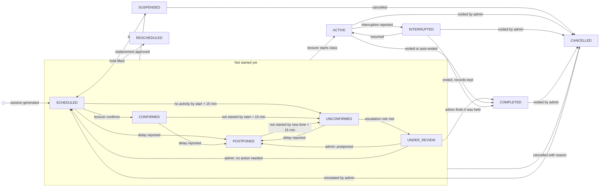

# Timetable and class lifecycle

A published timetable is turned into one class session per meeting for the whole semester, before any class starts. Each session then moves through 11 statuses, and only the transitions listed here are allowed. Every change is recorded as a class event with who made it and why.

**Status:** design draft (2026-11-08). Monitoring rules that drive the automatic transitions are in [CLASS_MONITORING.md](CLASS_MONITORING.md).

## 1. Timetable lifecycle

| Status | Meaning |
| --- | --- |
| DRAFT | Being built. Entries can conflict here, and conflicts are listed for the editor. |
| PUBLISHED | Approved and live. Sessions are generated from it. Only one timetable per semester is published at a time. |
| SUPERSEDED | Replaced by a newer published version. Its past sessions stay exactly as they were. |
| ARCHIVED | The semester has closed. |

**Publishing** runs the conflict check. Publishing is blocked when, at overlapping times:

- a room has two entries,
- a lecturer has two entries, or
- a section appears in two entries.

Publishing raises a warning, but is not blocked, when individual students enrolled in two overlapping sections would clash. The editor sees which students are affected.

**Editing after publishing.** A change applies only to sessions that have not started. Sessions still `SCHEDULED` or `CONFIRMED` are updated in place. Each update writes a class event and sends affected students a notification. A time change that moves a session to another day replaces it: the old session is cancelled with reason `OTHER` and the note "timetable changed", and a new one is created. Sessions that have started or finished are never touched. Every edit is written to `TimetableChange`.

## 2. Session generation

When a timetable is published, a background job runs over every active entry. For each date between the entry's `effectiveFrom` and `effectiveTo` that matches its weekday and recurrence, it creates a class session. Recurrence (decided 2026-11-09): `WEEKLY` (default), `EVERY_OTHER_WEEK` (counted from the first meeting on or after `effectiveFrom`, so the first class is never skipped), `SELECTED_WEEKS` (listed teaching weeks, week 1 = the semester's first week) or `ONCE` (a single date):

- The date is skipped when a calendar exception (public holiday, closure, exam period) covers it, or when the entry has its own exception for that date.
- Start and end times are converted from Africa/Accra wall-clock time to UTC.
- Each session copies the entry's lecturer, room and sections.
- The unique key `(timetableEntryId, scheduledStart)` means a re-run never creates duplicates.
- A `GENERATED` event is written for each session, and the monitoring checkpoints are scheduled (CLASS_MONITORING.md, Phase 3 step 5).
- Only meetings still in the future get sessions; a session that has started or lies in the past is never touched.

**A new version replacing a published one** (built in Phase 3 step 2–3). Each entry of the new version remembers the entry it was copied from. Generation then reconciles instead of starting again:

- A future meeting that still exists keeps its session (the same row, so a lecturer's confirmation and its history stay) and moves to the new version's entry.
- If the lecturer, room, end time or sections changed, a session that has not started is updated in place, with an `UPDATED` event (`VENUE_CHANGED` when only the room changed).
- A session that was already cancelled or rescheduled keeps that status; a timetable change never brings a cancelled class back.
- A future meeting that no longer exists (entry removed, or its start time changed) is cancelled with reason `OTHER` and the note "Timetable changed", recorded as the publishing administrator's act. This is the administrator's decision to change the timetable, not an automatic cancellation by the monitoring system.
- New meetings get new sessions.

*Why generate the whole semester at once:* a few thousand rows is small for PostgreSQL. It lets the student app show "34 classes remaining". It also lets the database's no-overlap constraints check concrete sessions, not just repeating patterns.

## 3. The 11 class statuses

| Status | Meaning | Counts toward attendance? |
| --- | --- | --- |
| SCHEDULED | Generated from the timetable; nothing has happened yet | Not yet |
| CONFIRMED | The lecturer has said they will teach it | Not yet |
| POSTPONED | The lecturer reported a delay; a new expected start is set within the same slot | Not yet |
| UNCONFIRMED | Start time + 15 min passed with no lecturer activity | Not yet |
| UNDER_REVIEW | Escalated; an administrator must decide what happened | Not until decided |
| ACTIVE | The lecturer started the class | In progress |
| INTERRUPTED | Started, then stopped by an interruption (power cut, emergency) | Decided when it resumes or ends |
| COMPLETED | Ended | Yes, if attendance was taken |
| CANCELLED | Officially cancelled, with a reason and the person who cancelled it | No |
| RESCHEDULED | Replaced by a new session at another time; the original stays for history | No (the replacement counts) |
| SUSPENDED | Put on hold by an administrator (closure, investigation) | No |

## 4. Allowed transitions

"Not started yet" covers SCHEDULED, CONFIRMED, POSTPONED, UNCONFIRMED and UNDER_REVIEW. An arrow from the group means the transition is allowed from any of them, subject to the rules in the table.

| From | To | Trigger | Who may do it | Rules and side effects |
| --- | --- | --- | --- | --- |
| — | SCHEDULED | Session generated, or make-up/replacement approved | System | Monitoring checkpoints scheduled |
| SCHEDULED | CONFIRMED | Confirm from a reminder | Assigned lecturer | — |
| SCHEDULED, CONFIRMED, UNCONFIRMED | POSTPONED | Report delay with minutes and reason | Assigned lecturer, Administrator | The new expected start must leave at least 30 min before the scheduled end, otherwise cancel or reschedule. Students are notified immediately and monitoring restarts from the new time. |
| UNDER_REVIEW | POSTPONED | Review decision "postponed" | Administrator | Same rules as a reported delay |
| UNDER_REVIEW | SCHEDULED or CONFIRMED | Review decision "no action needed" | Administrator | Only before scheduled start + 15 min (for example, a timetable-error report that proved wrong). Returns to CONFIRMED if the lecturer had confirmed. |
| SCHEDULED, CONFIRMED, POSTPONED | UNCONFIRMED | No lecturer activity by (expected) start + 15 min | System | Lecturer prompted with action buttons |
| UNCONFIRMED | UNDER_REVIEW | Escalation rule met | System | Review opened; administrator notified |
| Any not-started status | UNDER_REVIEW | Opened manually | Administrator | — |
| Any not-started status | ACTIVE | Start class | Assigned lecturer | Allowed from 15 min before the scheduled start until the scheduled end. Starting from UNDER_REVIEW automatically adds a note to the open review. |
| Any not-started status, SUSPENDED | CANCELLED | Cancel with reason code and note | Lecturer (not from SUSPENDED); Administrator; Super Admin | Excluded from attendance. Students and course reps are notified immediately. `LECTURER_ABSENT_NO_NOTICE` may only be set by an administrator. |
| Any not-started status | RESCHEDULED | Reschedule request approved, or a direct reschedule | Administrator (D-11): approves a lecturer's request, or reschedules directly in exceptional cases with a reason | Conflicts are checked and shown before approval; original kept; replacement session created; the database rejects a clash even if two approvals race; everyone notified; fully audited |
| Any not-started status | SUSPENDED | Administrative hold | Administrator, Super Admin | Students told the class is on hold |
| SUSPENDED | SCHEDULED | Hold lifted | Administrator | Only before the scheduled end |
| UNDER_REVIEW | COMPLETED | Administrator decides the class was held | Administrator | No attendance was taken, so the session does not count for anyone (ATTENDANCE_FLOW.md §9) |
| ACTIVE | COMPLETED | End class | Assigned lecturer; System auto-ends at scheduled end + 30 min | Auto-end writes `AUTO_ENDED` and notifies the lecturer |
| ACTIVE | INTERRUPTED | Report interruption | Assigned lecturer, Administrator | Attendance stays as recorded |
| INTERRUPTED | ACTIVE | Resume | Assigned lecturer | Before the scheduled end |
| INTERRUPTED | COMPLETED | End, keeping records | Assigned lecturer, Administrator | — |
| ACTIVE, INTERRUPTED, COMPLETED | CANCELLED | Void after attendance started | Administrator (the lecturer may request it) | Needs a reason. Attendance session set to `VOIDED`. Every record set to `VOIDED` with a correction row keeping its previous status. Nothing is deleted. |
| CANCELLED | SCHEDULED | Reinstate a mistaken cancellation | Administrator | Only before the scheduled end, and only if no attendance was voided. Students are notified. |

Every other transition is refused. COMPLETED, CANCELLED and RESCHEDULED are final, apart from the void and reinstate rows above. Students and course reps never change a class's status.

### Cancellation reasons

`LECTURER_UNAVAILABLE`, `ILLNESS`, `OFFICIAL_DUTY`, `VENUE_UNAVAILABLE`, `INSTITUTION_EVENT`, `PUBLIC_HOLIDAY`, `EMERGENCY`, `LECTURER_ABSENT_NO_NOTICE` (administrators only), and `OTHER`, which needs a note. Reports group cancellations by reason.

## 5. Rescheduling

1. The lecturer requests a new time and room, with a reason. A course rep's make-up suggestion can be accepted as the starting point.
2. The service checks for conflicts in the room, the lecturer's timetable and the students' sessions. It shows the result before the request is sent.
3. An authorised administrator approves or rejects it (D-11), after seeing the conflict check. In exceptional cases an administrator may reschedule directly, without a request; a reason is then required and the action is fully audited. On approval (or a direct reschedule), one transaction:
   - creates the replacement session (`kind = REPLACEMENT`),
   - links the original and the replacement,
   - sets the original to `RESCHEDULED`.
   The database's no-overlap constraints reject a clash even if two approvals race.
4. Students, course reps and the lecturer are notified with the old and new times.

## 6. How a status change is applied

`ClassEventService` is the only code allowed to change a class status. In one transaction it:

1. loads the session,
2. checks that the transition is in the shared transition table and that the actor may perform it,
3. updates the session with `WHERE status = <expected> AND version = <n>`,
4. writes the class event and the audit entry,
5. adds outbox rows for notifications and monitoring updates.

If the update matches no row, someone else changed the session first. The caller gets a clear conflict error and sees the current state, instead of overwriting it.
