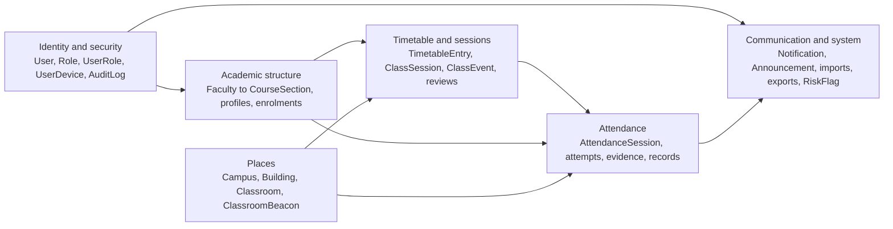
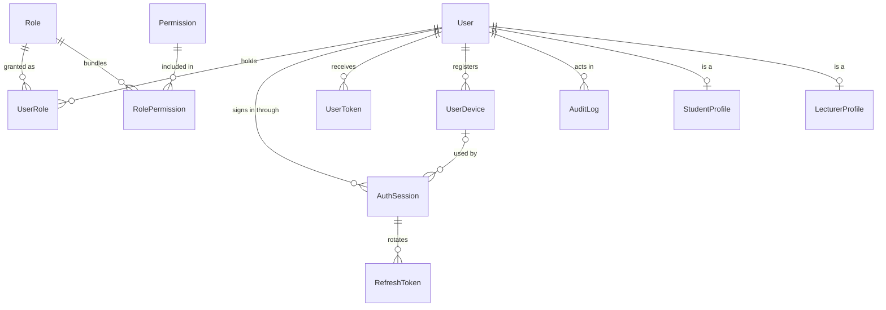
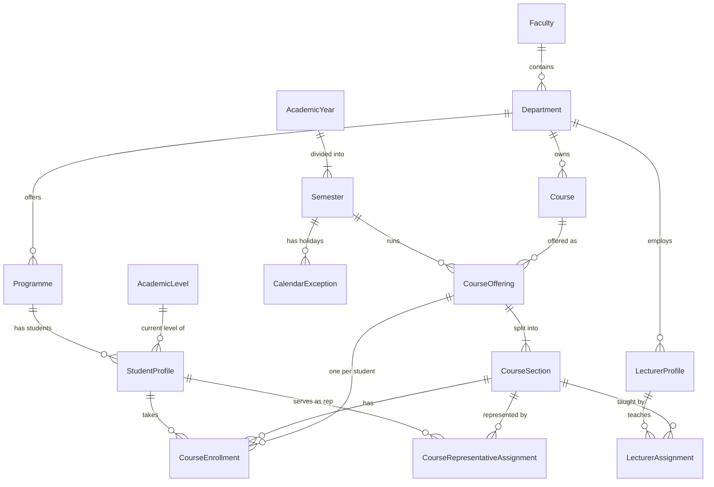
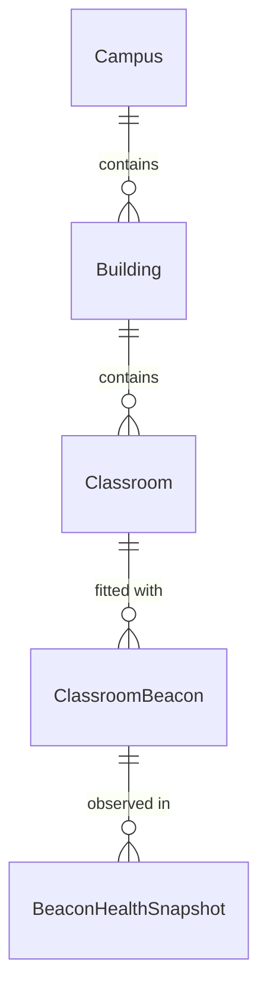
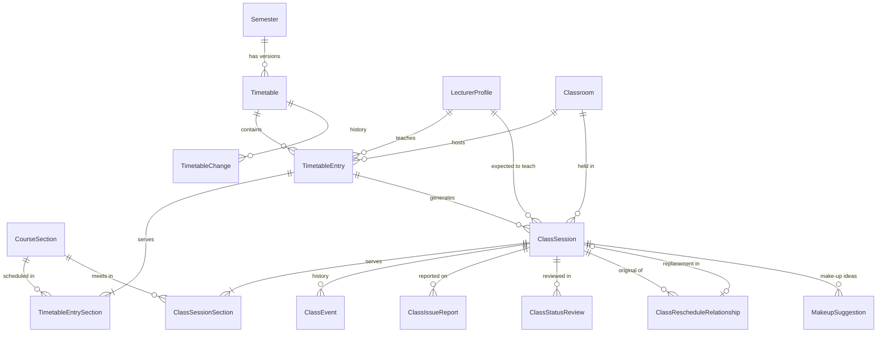
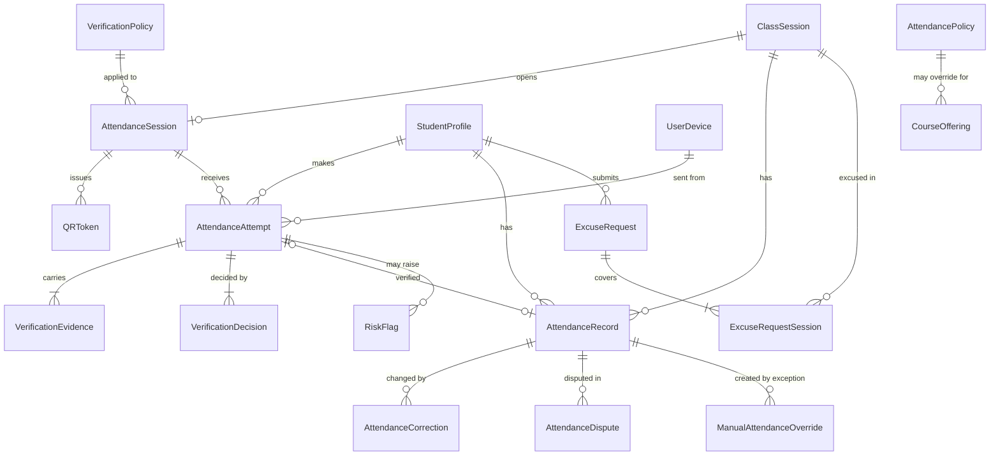
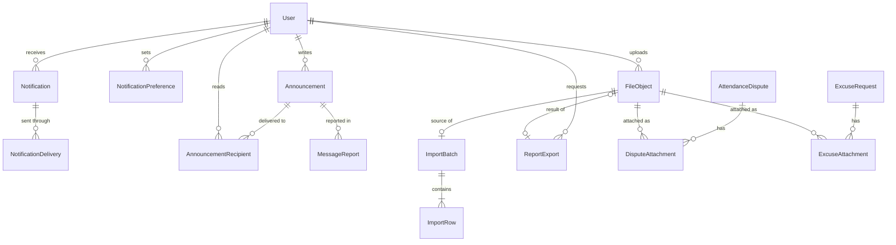

# Entity-relationship diagrams

The schema has about 60 tables, so it is drawn as six domain diagrams rather than one unreadable poster. Field-level detail, constraints and indexes are in [DATABASE_SCHEMA.md](DATABASE_SCHEMA.md).

Reading the notation: `||--o{` means "one to zero-or-more", `||--|{` means "one to one-or-more", `||--o|` means "one to zero-or-one". The diagrams render on GitHub. In VS Code, install a Mermaid preview extension.

## How the domains connect

## 1. Identity and security

## 2. Academic structure

## 3. Places

## 4. Timetable and class sessions

## 5. Attendance and verification

`AttendancePolicy` applies by scope (institution, faculty, department or offering) rather than by a foreign key. The last line shows that relationship conceptually.

## 6. Communication, files and system

`InstitutionSetting`, `SystemEvent`, `BackgroundJobRecord` and `OutboxEvent` stand alone and have no relationships worth drawing.
