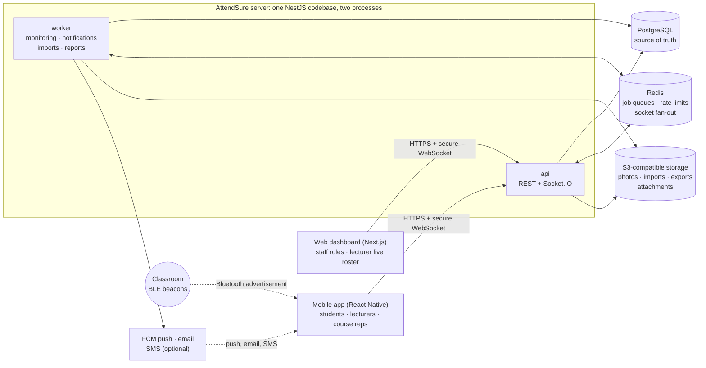

# System architecture

AttendSure is one TypeScript repository with three apps: an API, a web dashboard and a mobile app. They share types and rules through one shared package. Only the API makes attendance and class-status decisions.

**Status:** Phase 0 design (2026-11-08). Nothing in this document is built yet. Open decisions are tracked as D-01 to D-20 in [IMPLEMENTATION_PROGRESS.md](../IMPLEMENTATION_PROGRESS.md#open-decisions).

## 1. What AttendSure is

AttendSure is Knutsford University's own attendance and class-monitoring system. It is not a QR-scanning app and not a product for many universities. It does four jobs.

1. **Keeps the academic structure.** Authorised staff enter faculties, departments, programmes, levels, academic years, semesters, courses, sections, students, lecturers, enrolments and classrooms. Nothing about Knutsford is hardcoded or invented.
2. **Knows when every class should happen.** A published timetable becomes concrete class sessions before they start. The server watches each one. It notices when a lecturer has not started, collects reports from students and course reps, asks the lecturer what is happening, and escalates to an administrator. It never cancels a class by itself.
3. **Confirms attendance only for students who are in the room.** The student scans a QR code that changes every 15 seconds. At the same moment the phone collects evidence: the classroom beacon's Bluetooth signal, one GPS reading and the trusted device's identity. The server weighs that evidence against a written policy. It returns one of: verified, pending lecturer review, needs manual review, or rejected. The phone never decides.
4. **Gives each role the tools it needs and nothing more,** enforced on the server.

| Role | Main surface | In one line |
| --- | --- | --- |
| Super Admin | Web | Controls the whole installation: accounts, roles, policies, audit |
| University Administrator | Web | Runs courses, classrooms, timetables and class monitoring within an assigned scope |
| Registrar | Web | Owns student records, bulk imports and enrolments |
| Lecturer | Mobile and web | Runs classes and attendance for assigned courses only |
| Student | Mobile | Checks in, follows the timetable, tracks attendance |
| Course Representative | Mobile, inside the student app | A student who reports class problems and sends course updates. Cannot touch attendance. |

This matches the information architecture already drawn on the [design canvas](https://claude.ai/artifact/QA6eYPCN51FNpWASQbgLUV).

## 2. The big picture



How to read it: phones and browsers talk only to the API. Beacons never talk to the server; they broadcast, and the phone reports what it heard. The worker runs the class-monitoring timers, sends notifications, processes bulk imports and builds report files. PostgreSQL holds every record. Redis holds only things that can be rebuilt.

## 3. Key decisions, explained

**3.1 One API application with clear internal modules (a "modular monolith"), not microservices.** All server code is one NestJS application organised into about 30 modules (section 5). The same code runs as two processes: `api` answers requests and `worker` runs background jobs. *Why:* many operations must change several kinds of records at once. For example, closing attendance updates the session, creates absent records and writes audit entries. One database transaction makes that all-or-nothing. Microservices would split those records across services and make that much harder. Clear module boundaries still let us split a piece out later if it ever becomes necessary.

**3.2 The server decides; the phone reports.** The mobile app and web dashboard collect input and display results. Every decision is made in the API using the server's clock: whether a check-in is verified, whether a student is late, what status a class has. *Why:* anything on a student's phone can be modified by a determined student. The server cannot be.

**3.3 One repository with shared rules.** A `packages/shared` package holds the Zod validation schemas, status names, permission keys and the allowed class-status transitions. The API, web and mobile apps all import it. *Why:* a status name or validation rule can never drift between apps. A change in one place shows up as a type error everywhere it matters.

**3.4 The database enforces the rules that must never break.** PostgreSQL has a unique constraint for one attendance record per student per class, and exclusion constraints so no room or lecturer is double-booked. Foreign keys and check constraints guard the rest. The application also checks these things so users get clear error messages. *Why:* when 300 students check in within the same minute, two requests can pass an application check at the same instant. The database is the only place that can reliably reject the second one.

**3.5 Timers run as background jobs, with a safety net.** Each class gets scheduled jobs: a reminder 24 hours before, a check 15 minutes after the start, and so on. The jobs run on BullMQ, a job queue that stores its work in Redis. Separately, a sweeper re-checks the database every minute for any class that missed its checkpoint. Every job is idempotent: running it twice has the same effect as running it once. *Why:* if a job is ever lost, a class must still not go unmonitored.

**3.6 Follow-up work cannot get lost (the outbox).** When a change needs follow-up work, the API writes the change and an outbox row in the same transaction. For example, cancelling a class means 120 students must be notified. A relay then moves outbox rows into the job queue. *Why:* if Redis is unavailable for a minute, the work waits safely in the database instead of disappearing.

**3.7 Live updates over WebSockets; REST stays the source of truth.** The lecturer's roster updates instantly through Socket.IO. A Redis adapter lets several API instances share connections. Every message carries a sequence number. A client that sees a gap reloads the roster over REST. *Why:* a dropped connection on a classroom Wi-Fi network must never leave the lecturer looking at a wrong roster.

**3.8 Server time, stored in UTC.** Every timestamp is stored as `timestamptz`. Knutsford's time zone, Africa/Accra (UTC+0, no daylight saving), is a setting, not an assumption in the code. Device clocks are never trusted.

**3.9 Everything Knutsford-specific is data, not code.** The academic structure, attendance thresholds, QR rotation interval, monitoring timings and verification rules are records that authorised roles edit. Changes are versioned and audited. The only seeded data is the six system roles and their permission keys.

**3.10 Mobile app: Expo development builds (pending D-01).** Expo is the framework the React Native team recommends for new apps. A "development build" is a custom version of the app that can include native modules for Bluetooth scanning, location, secure storage, push notifications and app-integrity checks. Expo Go, the generic preview app, cannot include them. Expo's cloud build service can produce iPhone builds from this Windows PC. If we ever need native code Expo cannot handle, `expo prebuild` produces the full native projects.

**3.11 IDs.** Records use UUID version 7. These IDs do not reveal how many records exist, and because they are time-ordered, database indexes stay efficient. Student and staff ID numbers are separate, human-facing fields with a configurable format (D-14).

### Example: what happens on a check-in

1. The student scans the QR code on the lecturer's screen. The app reads the token text.
2. For up to 6 seconds the app listens for Bluetooth beacons, and at the same time it takes one GPS reading.
3. The app sends the token, the evidence and a signature from the device's credential to `POST /check-ins`, with an idempotency key so a retry cannot create a duplicate.
4. The API validates the token, the enrolment and the session. It runs the verification engine and writes the attempt, evidence, decision and attendance record in one transaction.
5. The API pushes the roster change to the lecturer's screen and returns the outcome to the student. Details are in [ATTENDANCE_FLOW.md](ATTENDANCE_FLOW.md) and [PRESENCE_VERIFICATION.md](PRESENCE_VERIFICATION.md).

## 4. Folder structure

```
attendsure/                         this repository
├── apps/
│   ├── api/                        NestJS: REST API, Socket.IO gateway, background worker
│   │   ├── prisma/
│   │   │   ├── schema.prisma
│   │   │   ├── migrations/         includes hand-written SQL for exclusion constraints and triggers
│   │   │   └── seed.ts             system roles and permission keys only; never people or courses
│   │   ├── src/
│   │   │   ├── main.ts             starts the HTTP and WebSocket server
│   │   │   ├── worker.ts           starts the background-job worker
│   │   │   ├── app.module.ts
│   │   │   ├── config/             typed, validated environment configuration
│   │   │   ├── common/             guards, decorators, validation pipe, error filter,
│   │   │   │                       idempotency, request context, pagination
│   │   │   ├── infrastructure/     prisma, redis, queues, outbox relay, file storage,
│   │   │   │                       mail, push, sms, realtime gateway
│   │   │   └── modules/            one folder per module (section 5)
│   │   └── test/                   integration and end-to-end tests
│   ├── web/                        Next.js dashboard (App Router)
│   │   └── src/
│   │       ├── app/                (auth)/  super-admin/  admin/  registrar/  lecturer/
│   │       ├── features/           screen groups per domain (students, timetable, live roster …)
│   │       ├── components/         shared UI built on the design tokens
│   │       └── lib/                API client, session handling, realtime client
│   └── mobile/                     React Native (Expo development build)
│       └── src/
│           ├── navigation/         student, lecturer and course-rep navigators
│           ├── features/           check-in, schedule, attendance, notifications, profile, rep tools
│           ├── native/             wrappers for BLE scanning, location, device identity, integrity
│           ├── components/
│           └── lib/                API client, secure storage, query client
├── packages/
│   ├── shared/                     Zod schemas, enums, permission keys, transition tables, API types
│   └── design-tokens/              colours, type, spacing and radius (web CSS variables + mobile theme)
├── infra/
│   └── docker-compose.yml          local PostgreSQL, Redis, SeaweedFS (S3), Mailpit (email catcher)
├── docs/                           design documents
├── .github/workflows/              CI: lint, type-check, tests, migration check
├── CLAUDE.md
├── IMPLEMENTATION_PROGRESS.md
├── README.md
└── package.json                    npm workspaces root
```

## 5. Backend modules

| Group | Modules | Responsibility |
| --- | --- | --- |
| Platform | Auth, Users, Roles, Permissions, InstitutionSettings, AuditLogs | Sign-in, tokens, MFA, accounts, role grants and scopes, settings, the audit trail |
| Academic | AcademicManagement (Faculties, Departments, Programmes, AcademicLevels, AcademicYears, Semesters, Calendar), Courses (offerings, sections), Students, Lecturers, Registrars (imports), CourseRepresentatives, Enrollments | The university's structure, the people in it and who takes or teaches what |
| Places and time | Classrooms (campuses, buildings, rooms), Beacons, Timetables, ClassSessions | Where and when classes happen; timetable conflicts; session generation |
| Class monitoring | ClassMonitoring: `ClassSessionMonitorService`, `DetectionEngineService`, `ClassAlertService`, `ClassEventService` | Watching sessions, judging evidence of a problem, alerting, applying status changes |
| Attendance | Attendance (sessions, records, roster), QRVerification, BLEVerification, LocationVerification, DeviceVerification, VerificationEngine, FraudDetection | Check-in, evidence evaluation, decisions, risk flags |
| People-facing | Notifications, Announcements, Disputes, ExcuseRequests, Files | Messages to people, requests from people, uploaded documents |
| Insight and operations | Analytics, Reports, SystemHealth | Statistics, exports, health checks and alerts |

Rules every module follows:

- **A module owns its tables.** Other modules call its service methods and never query its tables directly. Analytics is the one exception: it reads through dedicated read-only queries and views.
- **Controllers stay thin:** validate input, check the permission, call a service, return the result.
- **Side effects travel as domain events.** For example, `ClassSessionCancelled` is consumed by Notifications, Attendance and Analytics. Work that must survive a restart goes through the outbox (3.6).

## 6. Web dashboard and mobile app

**Web (Next.js).** One shell with a collapsible sidebar for Super Admin, Administrator and Registrar, plus a lecturer area for the live roster on a classroom screen. Menu items are filtered by the permissions the API returns. Hiding a menu item is a convenience, never the security. The refresh token lives in an httpOnly cookie, and the access token stays in memory. Server state comes through TanStack Query, and forms use React Hook Form with the shared Zod schemas.

**Mobile (React Native).** The student tabs are Home, Schedule, Scan, Attendance and Profile. The lecturer tabs are Today, Schedule, Live, Reviews and Reports. Course-rep tools appear inside Home and Profile only while a rep assignment is active, as decided on the design canvas. TanStack Query handles server data, Zustand small local state (active role, check-in progress), and React Hook Form with Zod the forms. Tokens and the device credential live in the operating system's secure storage.

**Design tokens** come from the design canvas (v0.1, proposed). The navy primary is a placeholder until Knutsford supplies brand colours (D-15).

| Token | Light | Dark |
| --- | --- | --- |
| Primary | #1F4B8F (hover #183C74, pressed #12305E) | #7FA6E6 |
| Primary tint / info background | #E9EFF8 | — |
| Background | #F5F6F8 | #0D1117 |
| Surface / elevated | #FFFFFF | #141A22 / #1B222C |
| Border / subtle | #DDE1E7 / #EEF0F3 | #2A3340 |
| Text primary / secondary / muted | #131820 / #465061 / #5F6878 | — |
| Success (text / background) | #12704A / #E6F3EC | #5BC48F |
| Warning (fill / text) | #D98A16 / #8F5300 | #E5A54B |
| Error (text / background) | #B3261E / #FBEAE8 | #EF7B70 |

Type: Inter at weights 400/500/600, tabular figures for times, IDs and percentages. Spacing is on a 4 px grid. Radius: 4 px for badges, 6 for buttons and inputs, 8 for cards, 12 for sheets. Touch targets are at least 44 × 44 px. Icons come from Lucide. Every status shows an icon and a word, never colour alone.

## 7. Dependencies and infrastructure

Exact versions are pinned when each package is installed in its phase, using the current stable release at that time.

| Area | Packages and services | Phase |
| --- | --- | --- |
| API core | `@nestjs/core`, `@nestjs/common`, `@nestjs/platform-express`, `zod` (environment and request validation through our own small modules) | 1 |
| Database | PostgreSQL 16 or newer, `prisma`, `@prisma/client` | 1 |
| Auth and security | `argon2` (password hashing), `jose` (JWT), `otplib` (TOTP), `helmet`, `@nestjs/throttler` with Redis storage | 1 |
| Logging and health | `nestjs-pino`, `pino`, `@nestjs/terminus`, `prom-client` | 1 |
| Jobs and realtime | Redis 7 with append-only persistence, `bullmq`, `@nestjs/bullmq`, `ioredis`, `@nestjs/websockets`, `@nestjs/platform-socket.io`, `socket.io`, `@socket.io/redis-adapter` | 1, 3 |
| Files | S3-compatible storage (SeaweedFS locally), `@aws-sdk/client-s3`, `@aws-sdk/s3-request-presigner`, `file-type` (checks real file type) | 2 |
| Imports and exports | `csv-parse`, `csv-stringify`, an XLSX library (SheetJS Community Edition from its official CDN, because the npm-registry copy is outdated, or ExcelJS; chosen in Phase 2 after a security check), `pdfkit` | 2, 7 |
| Notifications | Firebase project with `firebase-admin` (FCM), `nodemailer` or a provider SDK (D-17), SMS gateway SDK (D-17) | 3 |
| Web | `next`, `react`, `@tanstack/react-query`, `@tanstack/react-table`, `react-hook-form`, `@hookform/resolvers`, `socket.io-client`, Radix UI primitives (accessible dialogs, menus, selects), `qrcode` | 1+ |
| Mobile | `expo`, `react-native`, `@react-navigation/native` (+ bottom-tabs, native-stack), `@tanstack/react-query`, `zustand`, `react-hook-form`, `expo-camera` (QR scanning), `react-native-ble-plx`, `expo-location`, `expo-secure-store`, `@react-native-firebase/messaging`, `react-native-qrcode-svg`, an integrity module for Play Integrity and App Attest (chosen in Phase 4) | 1+ |
| Testing | `vitest` with `unplugin-swc` (NestJS 12 is an ES-module package; SWC keeps the decorator metadata Nest needs), `supertest`, `@testing-library/react`, `@testing-library/react-native`, Playwright (web end-to-end), Maestro (mobile end-to-end), k6 (load) | 1+ |
| Local services | Docker Desktop: PostgreSQL, Redis, SeaweedFS, Mailpit | 1 |

## 8. This computer today (checked 2026-11-08)

| Tool | Found | Needed for | Action |
| --- | --- | --- | --- |
| Node.js | v24.19.0 | Everything | Ready |
| npm | 11.17.0 | Workspaces, packages | Ready |
| Git | 2.56.0 | Version control | Ready. The folder is not a repository yet (D-04). |
| Docker | Installed 2026-11-08 (Docker Desktop 29.9.2, WSL 2) | Local PostgreSQL, Redis, SeaweedFS, Mailpit | Done (D-05) |
| PostgreSQL, Redis | Not found | — | Not needed directly once Docker runs them |
| Java | JDK 27; `JAVA_HOME` = `C:\Program Files\Java\jdk-27\bin` | Android builds | React Native's Android build recommends JDK 17. Install JDK 17 and point `JAVA_HOME` at the JDK folder itself, not at `bin`. |
| Android tools | `adb` 1.0.41 found; `ANDROID_HOME` not set | Android builds and emulator | Install Android Studio with the SDK and set `ANDROID_HOME` |
| iOS tools | — | iPhone builds | Needs a Mac, or Expo's cloud build service |

## 9. Technical risks

| # | Risk | Why it matters | Plan |
| --- | --- | --- | --- |
| R1 | Fixed beacon IDs can be copied: a phone or a cheap board at home can broadcast the same ID | Defeats the Bluetooth layer | Use rotating-ID beacons (D-08). Cross-check with GPS. Flag a beacon heard while GPS places the phone far away. The QR is still required. |
| R2 | iPhones hide iBeacon packets from ordinary Bluetooth scanning | iPhones would never hear an iBeacon-only beacon | Choose beacons that also broadcast Eddystone frames, which iOS scanning can see, or add an iOS location-ranging module. Prove it in the hardware trial. |
| R3 | Bluetooth passes through walls, and signal strength varies by phone model, pocket and crowd | A student next door could pass | Set a calibrated threshold per room and use several beacons in large halls. A weak signal goes to lecturer review. BLE is never the only evidence. |
| R4 | Indoor GPS is often 20–100+ m off, and mock-location apps exist | Unfair rejections, spoofing | GPS can reject only when the reading is accurate and clearly off-site. Android's mock-location flag is recorded. |
| R5 | Real-time collusion: a friend forwards the QR live, or carries an absent student's phone | Cannot be fully prevented without biometrics | Short QR life, BLE, device binding, risk flags, roster photos and headcount comparison. Documented in [KNOWN_LIMITATIONS.md](KNOWN_LIMITATIONS.md). |
| R6 | A lost background job means a class is never flagged | Monitoring fails silently | Sweeper (3.5), job records, alerts when jobs fail |
| R7 | Burst load at the start of large classes | Slow check-ins, timeouts | Stateless API, database constraints, idempotent retries, and a load test of 500 simultaneous check-ins before release |
| R8 | A bad bulk import corrupts student records | Data integrity | Staged import: validate, preview, confirm. Unique constraints stop duplicates. Per-row results. |
| R9 | Students refuse Bluetooth or location permission | They cannot be verified automatically | Plain-language screens explaining why before the system prompt, plus the exception workflow |
| R10 | Prisma cannot describe exclusion constraints or partial unique indexes | They need hand-written SQL migrations, and Prisma might try to drop them | Verify in Phase 1. CI checks that migrations leave them intact. |
| R11 | Ghana's Data Protection Act, 2012 (Act 843) | Legal exposure for the university | Data minimisation, retention limits, privacy notice, and the university's registration with the Data Protection Commission (D-16) |
| R12 | Push notifications are best-effort | A student misses a cancellation | The in-app notification centre is the record. Email or SMS for critical categories. Delivery tracking. |
| R13 | Poor classroom connectivity | Students cannot submit check-ins | Retries with the same idempotency key, a short offline grace period capped at "pending", and lecturer-assisted check-in |
